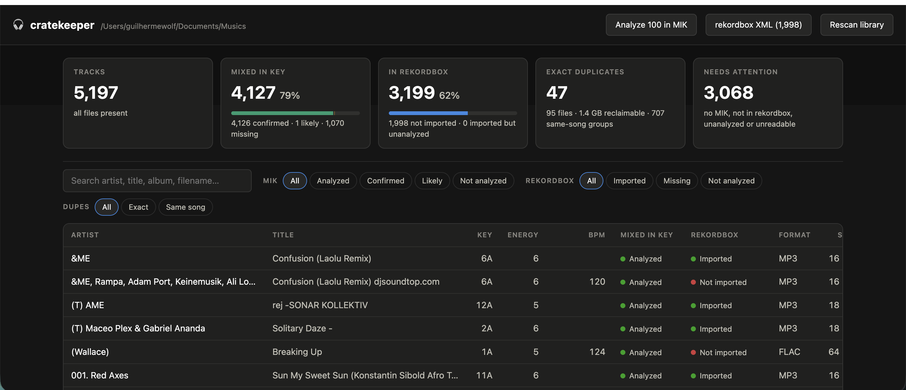

# 🎧 cratekeeper

**A 24/7 music library organizer for DJs.** cratekeeper indexes your music folder, finds
duplicate files, and answers the two questions every rekordbox + Mixed In Key user
keeps asking:

1. **Has this track been analyzed by Mixed In Key?**
2. **Is it actually imported (and analyzed) in rekordbox?**

Everything shows up in a dashboard where you can filter your entire library by
Mixed In Key status, rekordbox status, and duplicates — as a native macOS app
(`cratekeeper.app`, Apple Silicon + Intel) or as a local web page.



## Features

- **Library indexing** — walks your music folder, reads tags (artist, title, album,
  genre, BPM, key, energy, duration, bitrate) via [mutagen]. Supports mp3, flac,
  wav, aiff, m4a, ogg, opus. Rescans are incremental: unchanged files are skipped.
- **Mixed In Key detection** — MIK leaves a cryptographic-grade fingerprint in the
  files it analyzes (`GEOB:Key`/`GEOB:Energy` ID3 frames or base64 vorbis comments
  with `"source": "mixedinkey"`). cratekeeper reports:
  - `confirmed` — MIK signature found in the tags
  - `likely` — Camelot key + energy level present, but no MIK signature (analyzed
    by an old MIK version, or the frames were stripped by another tag editor)
  - `none` — not analyzed
- **rekordbox integration** — reads the rekordbox 6/7 encrypted `master.db`
  (read-only, via [pyrekordbox]) and matches your files against the collection by
  absolute path (Unicode-normalized, so accented filenames match), falling back to
  filename + file size for moved files and telling those apart from duplicate
  copies of a song rekordbox already has. Also shows tracks that are *imported but
  not yet analyzed* by rekordbox, collection entries whose file no longer exists,
  and a **Relocate** list: tracks rekordbox only knows at an old location, with
  the path where the file lives now.
- **MIK ≠ rekordbox** — flags tracks where Mixed In Key and rekordbox disagree
  on key (compared in Camelot) or BPM (half/double tempo noted).
- **New files since the last push** — files that appeared since you last pushed
  (or dismissed) them get a banner: push just those to Mixed In Key plus a
  rekordbox XML of the new ones, in one click. Moved or renamed files don't count
  as new.
- **Selections** — tick tracks (across pages and filters) and send them to MIK
  or export them as a rekordbox playlist XML.
- **Problem views** — tag errors (unreadable files) and missing files (gone from
  disk; forget them from the index in one click — files are never touched).
- **Duplicate detection** — two kinds:
  - *exact*: byte-identical files (two-tier hashing — cheap partial hash first,
    full SHA-256 only for collision candidates), including how much disk space
    you'd reclaim
  - *same song*: same normalized artist + title in different files (e.g. a FLAC
    and an MP3 of the same track)

  Each group gets a suggested copy to keep (the one rekordbox uses, then
  MIK-analyzed, lossless, higher bitrate); select or copy the paths of the extras
  and delete them in Finder if you agree.
- **Track detail view** — click any row for full metadata, the file's path, and
  the paths of every duplicate of it (with copy buttons).
- **Send to Mixed In Key** — one click opens the not-yet-analyzed tracks in MIK,
  which analyzes them and writes its tags; cratekeeper's watcher notices and flips
  them to *confirmed* automatically.
- **rekordbox import bridge** — one click downloads a rekordbox XML containing
  every track missing from your collection, as a ready-made playlist. Point
  rekordbox at it (Preferences → Advanced → Database → rekordbox xml) and import.
  cratekeeper never writes to the rekordbox database itself.
- **Runs 24/7** — a filesystem watcher picks up new files the moment Syncthing
  (or you) drops them, plus a periodic full rescan and rekordbox re-sync.
  `cratekeeper install-service` registers it with launchd so it starts at login and
  restarts on crash.
- **Updates** — checks GitHub for a new release every few hours and shows a
  banner (turn off with `check_updates = false` or the footer toggle). The
  desktop app can install updates itself — on request, or automatically with
  `auto_update = true`: it downloads the release's DMG, verifies its SHA-256 and
  code signature, and swaps the app in when you quit or restart.
- **Local-first** — your library data stays on your machine. SQLite database, no
  cloud, no telemetry; the only outbound request is the GitHub release check
  above (it sends nothing but a `cratekeeper/<version>` user agent). The
  rekordbox database is only ever opened read-only.

[mutagen]: https://mutagen.readthedocs.io/
[pyrekordbox]: https://pyrekordbox.readthedocs.io/

## Install

### macOS app (no Python needed)

Grab the DMG for your Mac from the [latest release](https://github.com/guilhermewolf/cratekeeper/releases/latest):

- `cratekeeper-<version>-macos-arm64.dmg` — Apple Silicon (M1 and newer)
- `cratekeeper-<version>-macos-x86_64.dmg` — Intel

Open it, drag **cratekeeper** to Applications, launch it and pick your music
folder when asked. The first scan starts right away.

The builds are ad-hoc signed (no Apple Developer certificate), so the first
launch may say the app is *"damaged"* or *"from an unidentified developer"*.
Clear the quarantine flag once and it opens normally:

```bash
xattr -dr com.apple.quarantine /Applications/cratekeeper.app
```

How the app behaves:

- Closing the window **hides** it — the watcher keeps indexing in the
  background. Click the Dock icon to bring it back; ⌘Q quits for real.
- If the `cratekeeper serve` launchd service is already running on the
  configured port, the app attaches to it instead of starting a second server.
- The bundle's executable is also the full CLI:
  `/Applications/cratekeeper.app/Contents/MacOS/cratekeeper scan|serve|install-service …`
  Use `install-service` from there to run 24/7 at login without the window.
- Track detail rows get a **Reveal** button (Finder), the rekordbox XML export
  uses a native save dialog, and the library folder is picked with a native
  folder dialog (click the path in the header to change it).

### From source

Requires macOS + Python 3.10+ ([uv](https://docs.astral.sh/uv/) recommended)
and rekordbox 6 or 7 if you want the rekordbox integration.

```bash
git clone https://github.com/guilhermewolf/cratekeeper && cd cratekeeper
uv venv && uv pip install -e .

# point cratekeeper at your music folder
.venv/bin/cratekeeper init ~/Documents/Musics

# index it (first run takes a few minutes for large libraries)
.venv/bin/cratekeeper scan

# start the dashboard
.venv/bin/cratekeeper serve
# → http://127.0.0.1:8321

# or the desktop window (needs the `app` extra: uv pip install -e ".[app]")
.venv/bin/cratekeeper app
```

### Run 24/7 (macOS)

```bash
.venv/bin/cratekeeper install-service
```

This writes `~/Library/LaunchAgents/com.cratekeeper.server.plist` and starts the
server. It launches at login, restarts if it crashes, and keeps watching your
library in the background. Remove with `cratekeeper uninstall-service`.

## Configuration

`cratekeeper init <path>` writes `~/.config/cratekeeper/config.toml`. All options:

```toml
library_path = "/Users/you/Documents/Musics"
# data_dir = "~/.local/share/cratekeeper"     # database + logs
# host = "127.0.0.1"
# port = 8321
# rescan_interval = 21600                # full rescan every 6 h
# rekordbox_poll_interval = 300          # check rekordbox db every 5 min
# extensions = [".mp3", ".flac", ".wav", ".aiff", ".aif", ".m4a", ".ogg", ".opus"]
# ignore_dirs = [".stfolder", ".stversions", ".sync"]
# check_updates = true                   # look for new GitHub releases
# auto_update = false                    # desktop app: install them automatically
```

The defaults for `ignore_dirs` skip Syncthing's internal folders.

## API

The dashboard is a thin client over a JSON API (interactive docs at `/docs`):

| Endpoint | Description |
|---|---|
| `GET /api/health` | identity + version (used by the app to detect a running server) |
| `GET /api/config` / `PUT /api/config` | read / change the library folder (`{"library_path": "..."}`) |
| `GET /api/stats` | library totals, MIK/rekordbox/duplicate breakdowns, scan progress |
| `GET /api/tracks` | paginated track list; filters: `search`, `mik`, `rekordbox` (`in`/`out`/`unanalyzed`/`relocate`), `dupes`, `issue` (`errors`/`missing`), `added=new`, `mismatch` (`key`/`bpm`), `sort`, `order` |
| `GET /api/tracks/{id}` | full detail for one track |
| `GET /api/duplicates?kind=exact\|meta` | duplicate groups, best copy first (`keep`) |
| `GET /api/duplicates/extras?kind=…` | ids + paths of every copy except each group's keeper |
| `GET /api/rekordbox/orphans` | rekordbox entries with no matching file in the library |
| `GET /api/new` / `POST /api/new/ack` | files first seen since the last push / mark them seen (`{"until": ts}`) |
| `POST /api/missing/forget` | drop index rows of files gone from disk (files untouched) |
| `POST /api/scan` | full rescan + rekordbox re-sync and rematch |
| `POST /api/rekordbox/sync` | force a rekordbox re-sync |
| `POST /api/actions/mik?limit=N[&since=&until=]` | open unanalyzed (optionally only new) tracks in Mixed In Key |
| `POST /api/actions/mik/selection` | open `{"ids": [...]}` in Mixed In Key |
| `GET /api/export/rekordbox.xml[?since=&until=\|?ids=1,2]` | rekordbox XML: tracks missing from the collection, only new ones, or a selection as a playlist |
| `GET /api/update`, `POST /api/update/check\|install\|restart`, `PUT /api/update/settings` | release check and desktop self-update |

## How the checks work

**Mixed In Key**: MIK writes its analysis into the audio file itself. On MP3/AIFF
it adds `GEOB` frames named `Key` and `Energy` containing JSON like
`{"algorithm": 94, "key": "9A", "source": "mixedinkey"}`; on FLAC it writes the
same JSON base64-encoded into `key`/`energy` vorbis comments. cratekeeper parses these
for a definitive answer instead of guessing from the comment field.

**rekordbox**: rekordbox 6/7 stores its collection in an SQLCipher-encrypted
SQLite database (`~/Library/Pioneer/rekordbox/master.db`). pyrekordbox decrypts
it read-only. cratekeeper mirrors the collection, matches it against your files, and
reads rekordbox's own `Analysed` flag to tell you which imported tracks still
need waveform/grid analysis.

## Development

```bash
uv pip install -e ".[dev,app,build]"
pytest            # run tests
ruff check .      # lint
```

### Building the macOS app

```bash
scripts/build_macos.sh
# → dist/cratekeeper-<version>-macos-<arch>.dmg (+ .zip)
```

The script renders the `.icns` from `packaging/icon.png`, runs PyInstaller with
`packaging/cratekeeper.spec`, signs the bundle (ad-hoc, or with
`MACOS_SIGN_IDENTITY` if set), smoke-tests the CLI, the headless server *and*
the window, then packages a DMG. It builds for the architecture of the machine
it runs on; CI (`.github/workflows/build.yml`) runs it on both an Intel and an
Apple Silicon runner on every push, and attaches both DMGs to a GitHub release
when you push a `v*` tag:

```bash
git tag v0.3.0 && git push origin v0.3.0
```

To ship notarized builds, add repository secrets `MACOS_CERTIFICATE_P12`
(base64 of the Developer ID .p12), `MACOS_CERTIFICATE_PASSWORD`,
`MACOS_SIGN_IDENTITY`, `APPLE_ID`, `APPLE_TEAM_ID` and `APPLE_APP_PASSWORD`;
the workflow picks them up automatically.

See [CLAUDE.md](CLAUDE.md) for architecture notes (also used by AI coding agents).

## License

MIT
